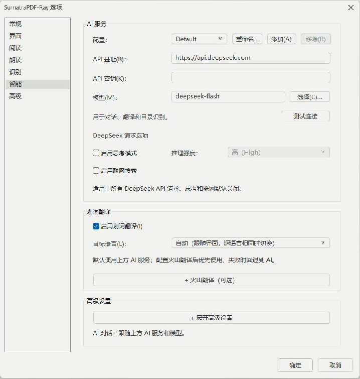
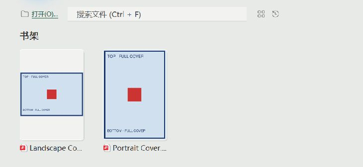

# SumatraPDF-Ray

基于 [SumatraPDF-Plus](https://github.com/dengxibo/sumatrapdf-plus) 的 Windows 阅读器，侧重阅读主题、书架布局和 AI 设置体验。

这是独立维护的社区修改版，不是 SumatraPDF 或 SumatraPDF-Plus 的官方发行版。

**[下载 Windows x64 版本](https://github.com/C-SunRay/SumatraPDF-Ray/releases/latest)** · [反馈问题](https://github.com/C-SunRay/SumatraPDF-Ray/issues) · [编译说明](docs/ray/BUILD.md)

## Ray 的改动

- 应用名为 SumatraPDF-Ray，使用粉色 PDF 图标和细线 AI 工具栏图标。
- 主题下拉菜单集中提供阅读主题；“跟随系统”放在最后。
- 增加绿色阅读主题，区分页面与周围背景。
- 主页增加“书架”标题，使用更紧凑的竖向封面缩略图，按比例完整展示封面。
- 缩短主页搜索框，视图和排序按钮紧跟输入框。
- 工具栏 AI 按钮直接打开智能设置，全屏按钮位于其右侧。
- AI 页按“AI 服务 → 划词翻译 → 高级设置”组织；可选火山翻译和独立对话配置按需展开。
- 默认 API 地址为 `https://api.deepseek.com`，模型为 `deepseek-flash`；不附带 API 密钥。
- 提供 DeepSeek 思考模式、推理强度和联网搜索选项，思考和联网默认关闭。接口可用性取决于服务商及所选模型。
- 移除设置页中原有的网页 AI 功能控件。
- 更新与反馈入口指向 Ray 仓库。

## 使用

从 Releases 下载 `SumatraPDF-Ray.exe`，或下载包含许可说明的便携 ZIP。关闭旧版程序后运行。

普通文档阅读可使用单个 EXE。OCR 模型、离线词典、额外字体及部分语音功能需要另外配置资源，EXE 不包含所有可选资源。相关能力继承自 Plus，参见其项目说明。

AI 功能需要填写自己的 API 密钥，并遵守服务商的使用与计费规则。使用 AI 时，所选文本或相关文档内容会发送到你配置的服务；开启联网搜索时还会使用服务商的搜索能力。

`SumatraPDF-settings.txt` 是自动生成的本机个人配置，可能包含 API 凭据、阅读记录和本地文件路径。请勿上传到仓库、附在问题报告中，或随 EXE 发给别人。截图和日志也请先移除敏感内容。

## 源码与构建

本版本基于 Plus 的 `3.7.94` 源码包，对应提交：

`34fecf53bee0a14d028a8499bd8b3be1d1aac54c`

Ray 开发分支为 `ray`，首次发行标签为 `v3.7.94-ray.1`。对应源码和构建入口随发行提供。内部基础版本号保留 `3.7.94`，Ray 发行迭代以标签区分。

见 [构建方法](docs/ray/BUILD.md)、[本次改动](docs/ray/CHANGELOG.md) 和 [上游 README 留档](docs/ray/UPSTREAM-README.md)。

## 致谢与许可

感谢 [SumatraPDF](https://github.com/sumatrapdfreader/sumatrapdf)、[SumatraPDF-Plus](https://github.com/dengxibo/sumatrapdf-plus)、MuPDF 及所有第三方项目的作者。

保留上游版权与许可声明。项目根目录提供 [GPLv3](COPYING)，部分组件使用其他许可证；其中 MuPDF 提供 [AGPLv3](mupdf/COPYING)，BSD 代码见 [COPYING.BSD](COPYING.BSD)。请结合 [AUTHORS](AUTHORS)、各依赖目录的许可文件和 [第三方许可说明](docs/ray/THIRD-PARTY.md) 使用和分发，不应把整套程序视为 MIT 项目。

Ray 新增的代码与资源按相应项目许可发布。发布二进制时，应同时提供对应源码、必要构建脚本及适用的版权和许可说明。
